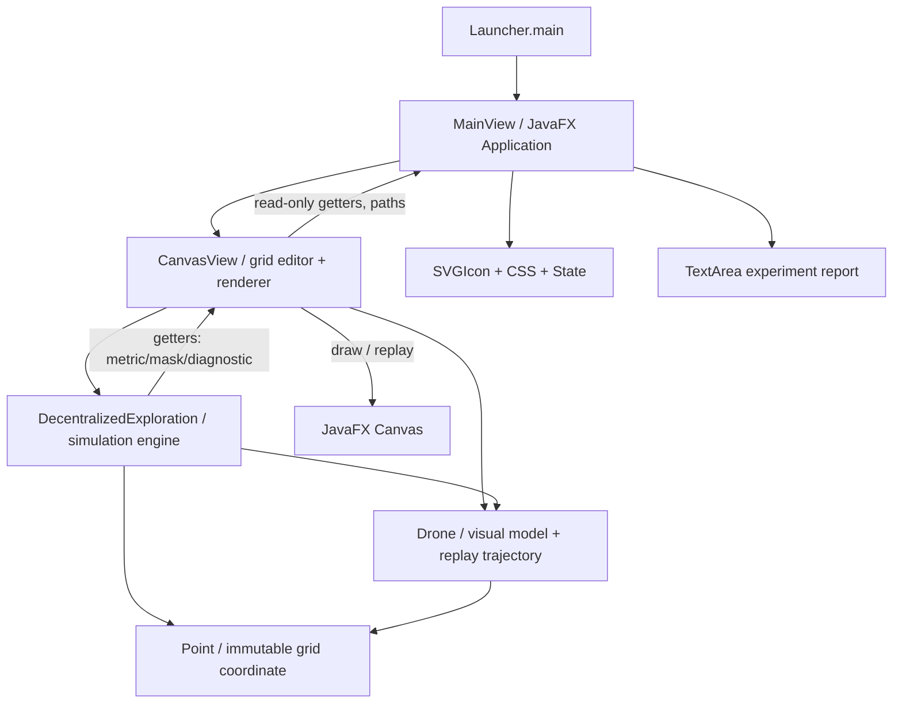
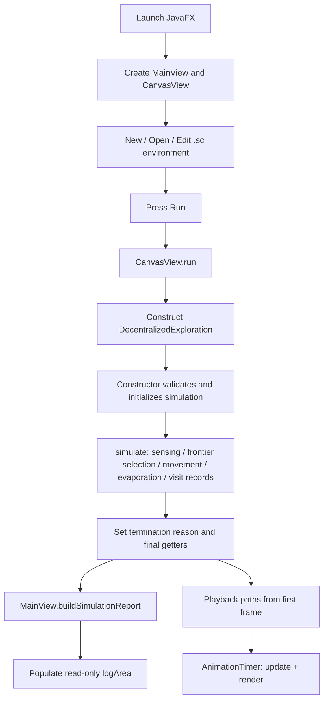

# V001_Decentralized-Swarm-Coverage-Using-Frontier-Based-Exploration-and-Repulsive-Pheromone-Stigmergy
# Decentralized Swarm Coverage Using Frontier-Based Exploration and Repulsive Pheromone Stigmergy

**Technical Source-Code Documentation — Diagnostic Patch v1.1a (frozen research algorithm)**  
**Application:** Robotics & Mechatronics Laboratory — Mechanical Engineering — Hasanuddin University  
**Language / UI:** Java / JavaFX  
**Documentation basis:** the **nine Java source files supplied on 21 October 2026**, not an inferred or earlier program snapshot.

> **Research status.** “Frozen” means the implementation is fixed for controlled experiments. It does **not** mean that every environment is guaranteed to reach 100% coverage or that the advantage of repulsive pheromone has already been statistically established. No algorithms or Java classes were modified to prepare this README.

## Table of contents

1. [Research purpose and scope](#1-research-purpose-and-scope)
2. [Five locked scientific components](#2-five-locked-scientific-components)
3. [Architecture and execution lifecycle](#3-architecture-and-execution-lifecycle)
4. [Project and package layout](#4-project-and-package-layout)
5. [Technical specifications and configuration](#5-technical-specifications-and-configuration)
6. [Algorithm data structures and interactions](#6-algorithm-data-structures-and-interactions)
7. [Detailed algorithm and method inventory](#7-detailed-algorithm-and-method-inventory)
8. [GUI, canvas, and class-method inventory](#8-gui-canvas-and-class-method-inventory)
9. [Four primary evaluation metrics](#9-four-primary-evaluation-metrics)
10. [The `.sc` environment file](#10-the-sc-environment-file)
11. [Experiment log, trajectories, and diagnostics](#11-experiment-log-trajectories-and-diagnostics)
12. [Installation and operation](#12-installation-and-operation)
13. [Screenshots and UI walkthrough](#13-screenshots-and-ui-walkthrough)
14. [Experimental protocol](#14-experimental-protocol)
15. [Implementation constraints and known cautions](#15-implementation-constraints-and-known-cautions)
16. [Reproducibility checklist and troubleshooting](#16-reproducibility-checklist-and-troubleshooting)
17. [Source-file inventory](#17-source-file-inventory)

---

## 1. Research purpose and scope

This simulator evaluates **decentralized swarm coverage** in an initially unknown, grid-based environment. Each drone obtains environmental information through **360-degree ray casting**, maintains its **own occupancy map**, detects frontier cells, and selects a frontier using **single-source Dijkstra shortest paths**. Coordination between drones is influenced by an **ideal globally shared repulsive-pheromone memory**: visited cells receive pheromone; this pheromone evaporates and penalizes candidate routes during frontier selection.

The primary comparison is between otherwise identical configurations:

- **Nearest-frontier baseline:** `swarm.lambda=0`.
- **Repulsive-pheromone method:** `swarm.lambda>0` (default `1.0`).

Both settings share sensing, planning, collision resolution, frontier exhaustion handling, and deadlock recovery. The goal is to **measure** whether repulsive pheromone improves coverage efficiency and reduces repeated or overlapping visitation—not to assume that it does.

**Scope boundary:** the software is a JavaFX **2D grid simulator**, not flight-controller firmware, a UAV hardware stack, a real-time distributed network, or a verified physical drone platform. JavaFX playback depicts the simulated paths after calculation.

## 2. Five locked scientific components

| Component | Actual mechanism | Source |
|---|---|---|
| Decentralized swarm coverage | Each agent maintains its own `goals`, `routes`, and `localMaps` and makes its own frontier selection; shared movement resolution occurs in the simulator | `DecentralizedExploration.java` |
| Local occupancy map + Ray-Casting 360° | `localMaps[id][r][c]`, updated by `sense()` and `discover()`; rays sampled at all integer degrees `0..359` | `DecentralizedExploration.java` |
| Frontier-based exploration | `isFrontier()` checks known-free cells next to unknown cells; `selectRoute()` evaluates reachable frontiers | `DecentralizedExploration.java` |
| Single-source Dijkstra | One priority-queue shortest-path tree per planning event, on 8-neighbor known-free space with diagonal cost `sqrt(2)` | `DecentralizedExploration.java` |
| Global movement-based repulsive pheromone | `pheromone[r][c]` is visible to all planners; evaporated globally, then increased at actual movement destinations | `DecentralizedExploration.java` |

**Important qualification:** the decisions are individual, but `pheromone[][]` is an ideal **central shared data structure** accessible by every drone. Consequently, the implementation should be described as **decentralized decision-making with globally shared virtual stigmergic memory**, not as fully distributed storage or realistic asynchronous networking.

### Summary of mathematical rules

For a frontier `f` and drone `i`, let `L_i(f)` be the geometric shortest-path length returned by Dijkstra, and `π_i(f)` its reconstructed path. The implementation uses:

```text
J_i(f) = L_i(f) + lambda * SUM(pheromone[c] for c in path excluding start)
selected frontier = argmin J_i(f)
```

Pheromone is repulsive because `lambda >= 0`, the deposits are nonnegative, and a greater path sum increases the target score. **Dijkstra itself remains pheromone-independent:** pheromone changes the chosen *frontier*, not the shortest-path edge costs. A frontier is never made physically impassable by pheromone.

At every simulation timestep:

```text
pheromone_next[cell] = (1 - rho) * pheromone_previous[cell]
                       + deposit * number_of_drones_entering(cell)
```

Movement-based means deposits occur on **successful entry to the destination cell**, including repeated entries to the same cell, but **not** when a drone stays still. There is **no diffusion**.

## 3. Architecture and execution lifecycle

### 3.1 Component dependency diagram



### 3.2 Full program lifecycle



**Key design detail:** invoking the `DecentralizedExploration` constructor calls `simulate()` immediately. The application first calculates a **complete trajectory and metrics**, then plays those trajectories in the GUI. `AnimationTimer` does not run or recompute the exploration algorithm every frame. Each `Drone.path` includes the initial point and one stored point for each subsequent simulation step, including stationary frames.

### 3.3 Responsibilities and call ownership

| Owner | Responsibilities | Must not be confused with |
|---|---|---|
| `MainView` | Controls, JavaFX stage, file dialogs, status, log report, UI event delegation | Frontier planner |
| `CanvasView` | Environment editing, `.sc` I/O, viewport transforms, drawing, replay control, launching computation | Drone decision-maker |
| `DecentralizedExploration` | Sensor/model updates, decisions, path search, physical collision resolution, pheromone, statistical counters | JavaFX rendering |
| `Drone` | Initial drone configuration, color, complete path history, visualization | Independent planner (decisions are not implemented here) |
| `Point` | Grid coordinate `(row,col)` | Screen pixels |
| `State` | Active editor mode | Algorithm state machine |
| `SVGIcon` / `CSS` | Toolbar graphic paths / JavaFX CSS | Simulation results |
| `Launcher` | Starting JavaFX application | Engine |

## 4. Project and package layout

All nine supplied Java classes declare this package:

```java
package swarmdrone.decentralizedswarmcoverage_ijrcs;
```

Recommended standard Maven/IntelliJ arrangement (the source upload does **not** include `pom.xml`, `module-info.java`, or resources, so these remain external prerequisites if needed by your project):

```text
DecentralizedSwarmCoverage_IJRCS/
├── README.md                         <-- this document
├── assets/
│   └── screenshots/
│       ├── 01-initial-window.png
│       ├── 02-environment-loaded.png
│       ├── 03-exploration-replay.png
│       ├── 04-parameters-and-replay.png
│       └── 05-final-metrics-and-trajectories.png
├── src/main/java/swarmdrone/decentralizedswarmcoverage_ijrcs/
│   ├── Launcher.java
│   ├── MainView.java
│   ├── CanvasView.java
│   ├── DecentralizedExploration.java
│   ├── Drone.java
│   ├── Point.java
│   ├── State.java
│   ├── SVGIcon.java
│   └── CSS.java
├── src/main/resources/swarmdrone/decentralizedswarmcoverage_ijrcs/
│   └── icon.png                       <-- expected by MainView; not supplied here
├── environments/
│   └── test001.sc                     <-- example user environment; not included in this README package
└── pom.xml / module-info.java        <-- use the existing IntelliJ configuration
```

The **uploaded filenames** contain timestamps; inside the actual Java package they need canonical names such as `MainView.java` and `DecentralizedExploration.java`. The README package provides **documentation and screenshots only**, not modified Java source files.

## 5. Technical specifications and configuration

### 5.1 Parameters present in the supplied code

| Item | Value / behavior | Defined in |
|---|---|---|
| Programming environment | Java using JavaFX (`Application`, `Canvas`, `AnimationTimer`, controls) | `Launcher`, `MainView`, `CanvasView`, `Drone` |
| Java language features | `record` (`Point`, private `Node`), modern pattern matching in `Point.equals` | `Point`, `DecentralizedExploration` |
| Grid at New/Reset | **200 rows × 400 columns** | `CanvasView` / `MainView` |
| Maximum `.sc` grid size | 200 × 400 (current file reader validation) | `CanvasView.readFromFile` |
| Grid cell size | 10 canvas-world units / cell | `MainView.cellSize` |
| Sensor radius | 4 cells | `CanvasView.sensorFoV` |
| Sensor directions | 360 angles, one ray per degree | `DecentralizedExploration.sense` |
| Sensor ray sampling | Distance increment `0.125` cell, to radius `+ 0.5` | `sense` |
| Allowed movement | 8 neighbors, no diagonal corner cutting through blocked geometry | `knownLegal`, `physicalLegal` |
| Straight / diagonal movement cost | `1` / `sqrt(2)` | `selectRoute` |
| Default `lambda` | `1.0` | JVM property `swarm.lambda` |
| Default `rho` | `0.05` | `swarm.rho` |
| Default deposit | `1.0` | `swarm.deposit` |
| Default deadlock recovery | `true` | `swarm.recovery` |
| Max simulation steps | `2500` | `swarm.maxSteps` |
| Stall limit | `30` consecutive no-movement steps | `swarm.stallLimit` |
| Playback frame interval | 95,000,000 ns ≈ 95 ms (approx. 10.5 steps/s) | `CanvasView` |
| Zoom | `MIN_SCALE=0.1`, `MAX_SCALE=20.0`, factor `1.05` | `CanvasView` |
| Pointer drag threshold | 4 display pixels | `CanvasView` |
| Path colors | 30 predefined colors, reused as required | `Drone.PATH_COLORS` |
| `.sc` delimiter | `:` | `CanvasView` |
| Diagnostic trace file | empty/disabled by default | `swarm.trace` |
| Trace last-step selector | `0` by default | `swarm.traceLast` |

**No exact JDK, JavaFX, Maven plugin, or dependency-version numbers can be confirmed from these nine files alone.** The supplied Java uses Java records and pattern matching, so select a compatible modern JDK (for example Java 17 or later) and the JavaFX runtime appropriate to that JDK. Check your existing `pom.xml` and `module-info.java` before asserting reproducible toolchain versions in the article.

### 5.2 JVM system properties

Provide these in IntelliJ **Run → Edit Configurations → Launcher → VM Options** (not as application arguments):

```text
-Dswarm.lambda=1.0
-Dswarm.rho=0.05
-Dswarm.deposit=1.0
-Dswarm.recovery=true
-Dswarm.maxSteps=2500
-Dswarm.stallLimit=30
```

For diagnostic tracing, optionally add:

```text
-Dswarm.trace=C:/temp/swarm_trace.csv
-Dswarm.traceLast=100
```

`swarm.traceLast=100` writes only the final 100 global timesteps **if trace output is enabled**; omitting `swarm.traceLast` or setting it to `0` retains all collected rows. The implementation validates `lambda>=0`, `0<=rho<=1`, `deposit>=0`, `maxSteps>0` and `stallLimit>0`, with finite checks for numeric pheromone parameters.

`lambda=0` is the no-pheromone **frontier-selection** ablation. The simulation still maintains the pheromone field and deposits while `lambda=0`; the field simply contributes zero to its frontier score. This maintains comparable execution logic.

## 6. Algorithm data structures and interactions

### 6.1 Grid and agent state

| Field | Type | Meaning | Read/written by |
|---|---|---|---|
| `truth` | `int[][]` | Ground-truth environment: `0` traversable, `-1` obstacle | Sensor, physics, evaluation; **not Dijkstra** |
| `localMaps` | `int[drone][row][col]` | Each drone's private occupancy state: `0` unknown, `1` known-free, `-1` known obstacle | `discover`, `sense`, `isFrontier`, `knownLegal`, Dijkstra |
| `pheromone` | `double[][]` | Shared virtual repulsive pheromone intensity per cell | `selectRoute` reads; `simulate` evaporates/deposits |
| `row`, `col` | `int[]` | Current true simulated position of every drone | Sensing, movement, collision, logging |
| `goals` | `Point[]` | Current selected frontier target for each drone | `simulate`, `yieldStep` |
| `routes` | `List<Point>[]` | Per-drone active path, including source at index 0 | `selectRoute`, `simulate` |
| `blockedCount` | `int[]` | Per-drone consecutive movement-blocking counter used by recovery logic | `simulate` |
| `mapVersion` | `int[]` | Revision counter advanced when a drone discovers a new local cell | `discover`, exhaustion logic |
| `exhaustedAtVersion` | `int[][][]` | Records locally unproductive frontiers for a map version | `simulate`, `selectRoute` |
| `N8` | `int[][]` | Fixed 8-neighbor ordering, used for legal moves and searches | Search, reachability, yielding |
| `SQRT2`, `EPS` | `double` | Diagonal distance and numerical tolerance | Planner, score comparison |

Note that `Node` is a **private nested record** inside `DecentralizedExploration`; it is not a new standalone Java class/file. It stores `(r,c,dist)` for priority-queue entries.

### 6.2 Observation, reachable-area and visitation records

| Field | Type | Meaning |
|---|---|---|
| `reachable` | `boolean[][]` | Ground-truth mask of free cells reachable from any initial drone location under physical legal moves; evaluation only |
| `reachableFree` | `int` | Number of required reachable-free cells |
| `firstObservedAt` | `int[][]` | First sensing timestep of a reachable-free cell; `-1` means never sensed |
| `observedReachable` | `int` | Count of distinct reachable-free cells sensed at least once |
| `visits` | `int[][]` | Number of **actual physical entries**, including initial starts, into each cell |
| `visitors` | `BitSet[]` | Set of drone IDs that have physically visited each cell |
| `totalVisits` | `int` | Total counted physical visits, including repeats and initial placements |
| `uniqueVisits` | `int` | Unique physical cells visited by at least one drone |
| `coverage` | `double` | **Physical visited coverage** (separate from primary observed coverage) |
| `revisit`, `overlap` | `double` | Primary physical visitation redundancy ratios |
| `steps` | `int` | Simulation timesteps performed before terminating |
| `terminationReason` | `String` | `ALL_REACHABLE_FREE_CELLS_OBSERVED`, `STALL_30_STEPS` (or configured limit), `MAX_STEPS`, etc. |

### 6.3 Data isolation rule

The oracle `truth` is necessary for **sensor simulation**, obstacle validation, and computing the ground-truth reachable mask; however, Dijkstra and frontier detection use `localMaps[id]` rather than `truth`. Global pheromone is not used to declare unseen cells free or obstacle. Separating these data paths is essential to the research claim that exploration decisions are based on locally sensed occupancy.

## 7. Detailed algorithm and method inventory

### 7.1 Initialization: `DecentralizedExploration(...)`

The public constructor:

1. Reads experiment properties and validates ranges.
2. Receives `environment` and a mutable `ArrayList<Drone>` from `CanvasView`.
3. Allocates independent `localMaps`, shared pheromone, reachable/evaluation arrays and per-drone goals/routes.
4. Validates initial positions: all must be traversable and distinct.
5. Resets every drone's `path` to its start position and initializes visitation counts.
6. Computes `reachableFree = markReachable()` using the **physical** environment for evaluation.
7. Calls `simulate()` synchronously.
8. Finalizes physical visited coverage, revisit and overlap, then prints diagnostics to standard output.

### 7.2 Full method reference: `DecentralizedExploration`

| Method | Inputs / outputs | Function and related state |
|---|---|---|
| `inside(r,c)` | coordinates → boolean | Grid-bounds check |
| `free(r,c)` | coordinates → boolean | True ground-truth traversability; physical simulation only |
| `physicalLegal(r,c,nr,nc)` | move → boolean | Validates obstacle, one-cell step, and diagonal-corner geometry using ground truth |
| `knownLegal(id,r,c,nr,nc)` | drone and move → boolean | Same local-movement constraints but only through locally **known-free** cells |
| `markReachable()` | → `int` | Flood-fills all free cells physically reachable from initial drone positions, with 8-neighbor rules; creates evaluation mask |
| `visit(id,r,c)` | drone, cell → void | Increments `totalVisits`; updates `visits`, `uniqueVisits`, `visitors` |
| `discover(id,r,c,t)` | drone, cell, timestep → void | Updates that drone's occupancy information; increments `mapVersion`; records first observed reachable-free cell |
| `sense(id,radius,t)` | drone, radius, timestep → void | Fires 360 simulated rays from cell center; samples at subcell increments; observes obstacles and stops rays at obstacles |
| `isFrontier(id,r,c)` | drone, cell → boolean | Returns true if the cell is locally known-free and has any unknown 8-neighbor |
| `selectRoute(id)` | drone ID → `List<Point>` | Runs one Dijkstra source search; scores reachable frontiers using path pheromone; returns chosen source-to-frontier route |
| `compare(a,b)` | two points → order | Deterministic row/column tie break |
| `simulate()` | → void | Main loop: sense, stop check, plan, propose moves, physical validation, collision resolution, recovery, evaporation/deposit, replay and counters, termination |
| `physicalLegalOrStay(id,next)` | next cell → boolean | Accepts staying or a legal physical move |
| `same(point,r,c)` | point, coordinates → boolean | Coordinate equality helper |
| `countFrontiers(id)` | drone → int | Counts a drone's current locally detected frontier cells, for diagnostic trace |
| `resolveMoves(next,reason,tick)` | proposed moves → void | Handles same-destination conflicts, head-on swaps, crossing diagonals, and entering stationary occupied cells |
| `crossingDiagonals(i,j,next)` | pair of drone IDs → boolean | Detects intersecting diagonal moves in the same tick |
| `yieldStep(id,next,tick)` | drone, proposed moves, tick → `Point` or `null` | Attempts a local alternate known-free step to break blockage; prefers position nearer current goal where feasible |
| `writeTrace()` | → void | Writes CSV trace to `swarm.trace`; supports last-N timestep truncation |
| `getCollisionRejects()` | → int | Collision rejection diagnostic |
| `getAlternateMoves()` | → int | Number of yielding/alternate moves |
| `getExhaustionEvents()` | → int | Number of temporary frontier-exhaustion events |
| `getFirstObservedAt()` | → `int[][]` | First observed timestep map (used by GUI reveal and report) |
| `getMustExploreMask()` | → `boolean[][]` | Reachable-free evaluation mask |
| `getSteps()` | → int | Terminal simulation timestep count |
| `getCoverage()` | → double | **Physical** visited coverage %, not primary observed coverage |
| `getRevisit()` | → double | Physical revisit ratio % |
| `getOverlap()` | → double | Inter-drone visitation overlap ratio % |
| `getObservedRatio()` | → double | Primary sensor-observed reachable-free coverage % |
| `getTerminationReason()` | → String | Termination condition/status |
| `getDecisions()` | → int | Number of calls to choose a route/frontier |
| `getChangedDecisions()` | → int | Number of selections differing from nearest geometric frontier within evaluated state |
| `getPositivePathDecisions()` | → int | Planning events with positive path pheromone on at least one candidate |
| `getDifferingPenaltyDecisions()` | → int | Planning events with variation in candidate path pheromone sums |
| `getSuccessfulMoves()` | → int | Actual movements executed |
| `getPheromone()` | → `double[][]` | Direct access to global pheromone field (diagnostic getter) |
| `getLocalMap(id)` | → `int[][]` | Direct access to individual drone occupancy map (diagnostic getter) |

### 7.3 Planner: single-source Dijkstra and frontier selection

`selectRoute()` sets `dist[source]=0`, initializes all other distances to infinity, and uses a priority queue with deterministic `(distance,row,col)` ordering. For each popped cell, it relaxes known-legal 8-neighbor moves. Straight steps cost `1`; diagonals cost `sqrt(2)`; diagonal corner cutting is disallowed. A `parent[row][col]` grid reconstructs any path in the shortest-path tree.

For each candidate frontier that is reachable, different from the current source cell, and not temporarily exhausted for that map version:

1. Walk its Dijkstra predecessor chain to the source.
2. Sum pheromone along that chain (the start cell is excluded).
3. Compute `score = dist + LAMBDA * penalty`.
4. Choose the smallest score, resolving ties by shortest distance then deterministic coordinate order.
5. Count diagnostic comparisons with nearest-distance selection.

This is **one Dijkstra pass per replanning event**, not one pass for every candidate. The algorithm uses fixed neighbor order and priority ordering to make deterministic ties more reproducible. It is important that `goals` and `routes` are reused across ticks when still valid: a fresh Dijkstra run is not necessarily performed every simulation timestep.

### 7.4 Ray-casting and observation update

- The drone's integer cell is observed first.
- Sensor origin is at the **center** of the current grid cell (`c+0.5`, `r+0.5`).
- For `degree=0..359`, the code computes `sin`/`cos` directions and advances subcell distance from `0.125` through `radius+0.5`.
- Every newly encountered cell is passed to `discover()`.
- Ray progression stops at the first obstacle or outside bounds.
- Newly observed free cells in the ground-truth reachable mask increment `observedReachable` once across the entire swarm.
- If one drone observes a cell, other drones **do not automatically receive that occupancy information**; they maintain independent maps.

The `Drone.drawSensoreVisibility()` function separately draws the **visual sensor polygon** for replay, with its own render sampling (`0.20 * cellSize`). This is a visualization representation, not a second exploration sensor controlling the planner.

### 7.5 Movement, collision, deadlock recovery, and exhaustion

The central loop performs **simultaneous movement proposals** independently from every drone, then uses a common physical resolver. `resolveMoves()` rejects conflicts such as same destination, mutual swaps, diagonal intersections, and moving into a stationary occupied cell. When `RECOVERY=true`, the loop can seek a locally legal alternative via `yieldStep()` to avoid persistent blockage. Actual moved cells are counted by `visit()`, their pheromone is incremented, and the per-drone replay paths receive a new frame regardless of movement success.

**Frontier exhaustion** uses `exhaustedAtVersion[id][r][c] = mapVersion[id]` to temporarily exclude a frontier encountered without progress for the **current local map version**. When sensing discovers any new cell, that drone's `mapVersion` increments, so the exclusion can expire. No drone receives another drone's exhausted-frontier list.

A stall means **no drone moved for `STALL_LIMIT` consecutive timesteps**. It is not a success. `MAX_STEPS` also signifies an incomplete run if reachable cells remain unobserved. Completion is only asserted after `observedReachable == reachableFree`.

### 7.6 Pseudocode matching the source

```text
INPUT: truth grid, drone start positions, sensor radius,
       lambda, rho, deposit, maximum steps, stall limit
INITIALIZE per-drone local maps/goals/routes; shared pheromone = 0
COMPUTE ground-truth reachable mask (evaluation only)
FOR each simulation timestep t:
    FOR each drone i: sense with 360 rays; update localMaps[i]
    IF all reachable-free cells observed: COMPLETE

    FOR each drone i:
        IF goal/route invalid:
            optionally mark exhausted frontier (recovery mode)
            route[i] = one-source Dijkstra + pheromone frontier scoring
        desired[i] = next route step, or stay
        validate movement with simulator physics

    resolve simultaneous occupancy and diagonal conflicts
    IF recovery enabled: attempt alternative yielding steps
    evaporate shared pheromone once
    FOR each drone i:
        IF moved: update position, physical visits, and deposit pheromone
        ELSE: update blocked/replan state as applicable
        append replay frame; optionally append diagnostic trace
    IF no swarm movement for configured stall limit: STALL
FINAL sensing, completion check, metrics, optional trace output
RESET replay position to frame 0
```

## 8. GUI, canvas, and class-method inventory

### 8.1 `MainView.java` — presentation, controls and logs

**Fields / components:** `btnNew`, `btnOpen`, `btnSave`, `btnTransform`, `btnAddDrone`, `btnRemoveDrone`, `btnWall`, `btnDrawLine`, `btnRemoveLine`, `btnRun`, `btnPlayPause`, `btnReplay`, `toolGroup`, `statusLabel`, `statelabel`, `fileChooser`, `primaryStage`, `progressIndicator`, `canvas`, `logArea`, `currentMapName`, grid defaults and `cellSize`.

| Method | Purpose / calls |
|---|---|
| `start(Stage)` | Builds sidebar, scrollable canvas, log TextArea and status bar; attaches handlers, starts `AnimationTimer` |
| `initializeButton(svg,scaleX,scaleY,tooltip)` | Builds ordinary buttons with JavaFX `SVGPath` |
| `initializeToggleButton(...)` | Builds selectable editing-mode buttons |
| `initializeToggleGroup()` | Makes editor modes mutually exclusive; maps each to a `State` value |
| `getCanvas()` | Lazily instantiates `CanvasView` and wires its mouse/scroll handlers |
| `handleMouseMoved/Released/Clicked/Scroll/Dragged/Pressed()` | Forward JavaFX events to corresponding `CanvasView` handlers |
| `handleButtonOpen()` | FileChooser → `CanvasView.readFromFile`; updates map filename/log/status |
| `handleButtonSave()` | FileChooser → `CanvasView.writeToFile`; ensures `.sc` extension |
| `handleButtonRun()` | Resets log → `canvas.run()` → `buildSimulationReport()` → starts replay status |
| `handleButtonPlayPause()` | Toggles replay playback |
| `handleButtonReplay()` | Rewinds and restarts replay |
| `showFileError()` | Displays a JavaFX error alert and updates status |
| `handleButtonResetEnvironment()` | Creates a new blank grid through `canvas.resetEnvironment()`; clears log |
| `clearSimulationLog()` | Clears `logArea` |
| `buildSimulationReport()` | Reads result getters and recorded paths; assembles experiment report, four primary metrics, exploration statistics and trajectories |
| `checkState()` | Synchronizes current editing state with toolbar selection and text |
| `AnimationTimer.handle(long)` | Repeatedly calls `canvas.update()` and `canvas.render()` for animation |

**Log features:** the bottom `TextArea` is read-only, non-wrapping, cleared automatically on Run/New/Open, and has a context menu containing **Clear Log** and **Copy All**. The report is generated **after the complete simulation has been computed**, not streamed live per decision.

**Source-specific visual detail:** the uploaded `MainView` renders `SVGPath` with `setFill(...)` and `setStroke(null)`; all toolbar icons are requested with `scaleX=1.0` and `scaleY=1.0`. `SVGIcon` contains path data only; hover/selection changes are handled in `MainView`.

### 8.2 `CanvasView.java` — editing, file I/O, rendering, playback

**Major fields:** `environment`, `wallType`, `drones`, `state`, `numRows`, `numCols`, `cellSize`, `sensorFoV`, camera `scale/translateX/translateY`, mouse gesture state, `lastExploration`, `playbackFrame`, `playbackPlaying`, `lastPlaybackTick`.

**Method groups and exact responsibilities:**

| Method(s) | Responsibility |
|---|---|
| `CanvasView(environment,cellSize)` | Initializes the world canvas and boundary/wall rendering state |
| `readHeaderInteger`, `readFromFile`, `writeToFile` | Validate/load/save `.sc` files (including drone initial coordinates) |
| `nextAvailablePathColorIndex()` | Chooses an unused drone trajectory color when possible |
| `getLastExploration`, `getReplayDrones`, `getGridRows`, `getGridCols`, `getSensorRangeCells` | Read-only access from `MainView` to report data/configuration |
| `hasReplay`, `totalPlaybackFrames`, `isPlaybackPlaying` | Playback query methods |
| `setPlaybackFrame`, `togglePlayPause`, `replay`, `clearReplay` | Replay cursor, pause/resume, rewind and clearing |
| `screenToWorldX`, `screenToWorldY` | Inverse camera transform: `(screen - translate)/scale` |
| `getColumnFromMouse`, `getRowFromMouse`, `isMouseInsideEnvironment`, `isValidGridPosition` | Map pointer positions to cells and enforce bounds |
| `checkWallType(i,j)`, `checkWallType()` | Compute wall boundary type from adjacent grid values for rendering |
| `getState`, `setState`, `setFreeTransform` | Editing-state query/change/reset |
| `resetEnvironment()` | Resets to blank 200×400 grid, removes drones, resets view and replay |
| `beginPointerGesture`, `updateDragGesture`, `clearCompletedClickGesture` | Track mouse press/drag/click distinctions and suppress accidental clicks |
| `handleMouseClicked` | Place/remove obstacle or add/remove drone in active mode |
| `handleMouseScroll` | Zoom about pointer; clamp view scale |
| `handleMousePressed`, `handleMouseMoved`, `handleMouseDragged`, `handleMouseReleased` | Begin line operations, hover preview, drone dragging and middle-button panning; finalize edits |
| `drawLineOnGrid(row0,col0,row1,col1,addObstacle)` | Rasterize continuous obstacle draw/erase line using an integer error-accumulation step (Bresenham-style) |
| `update()` | Advance playback frame at `PLAYBACK_INTERVAL_NS` |
| `render()` | Draw grid, obstacles, boundaries, unknown-cell overlay, observed/visited history, paths and drones |
| `run()` | Name drones, clear replay, create `DecentralizedExploration`, then start playback at frame zero |

**Gesture rules in the uploaded implementation:** left-click edits selected tools; default/transform mode supports dragging drone start positions; wheel scroll zooms; middle mouse drag pans the camera. `DRAG_THRESHOLD_PX=4` helps prevent treating a drag as a click. Model edits invalidate old replay (`clearReplay`).

### 8.3 `Drone.java` — graphical drone and trajectory

| Field / method | Role |
|---|---|
| `PATH_COLORS` | 30-color trajectory palette |
| `environment` | Renderer-only obstacle geometry (not planner state) |
| `initialRowPosition`, `initialColPosition` | Initial user-configured start |
| `rowPosition`, `colPosition` | Fallback position before valid replay frames |
| `sensorFoV`, `cellSize` | Rendering configuration |
| `name` | Display ID `D1`, `D2`, etc. |
| `path` (`ArrayList<Point>`) | Complete precomputed replay path, including stationary frames |
| `frameIndex` | Index of current replay timestep |
| `Drone(...)` | Initializes physical configuration and initial path point |
| `pathPaletteSize()` | Number of palette entries |
| `setName(name)` | Sets label |
| `setPathColorByIndex(index)`, `getPathColor()` | Color allocation/access |
| `draw(GraphicsContext)` | Renders body, four propellers, label and sensor footprint |
| `drawSensoreVisibility(GraphicsContext,sx,sy)` | Draws 360-ray occluded orange sensor polygon, **visualization only** |

**Coordinate convention:** The experiment log and `Point(row,col)` are **zero-based**, while the rendered drone labels use `renderRow + 1` and `renderCol + 1` (one-based). A screenshot label `(13,14)` corresponds to log coordinate `(12,13)` at the same instant.

### 8.4 Small supporting classes

| Class | Methods / constants | Purpose |
|---|---|---|
| `Launcher` | `main(String[] args)` → `Application.launch(MainView.class,args)` | JavaFX entry point |
| `Point` | `record Point(int row,int col)` and `equals(Object)` | Immutable grid positions; record-generated `row()`, `col()`, `hashCode()`, `toString()` also available |
| `State` | `DEFAULT`, `OBSTACLE`, `LINE`, `REMOVE_LINE`, `ADD_DRONE`, `REMOVE_DRONE` | GUI editing modes |
| `SVGIcon` | Static string paths `newEnv`, `openEnv`, `saveEnv`, `transform`, `addDrone`, `removeDrone`, `wall`, `drawLine`, `removeLine`, `run`, `playPause`, `replay` | 12 toolbar SVG geometries |
| `CSS` | `public static final String style` | In-memory CSS stylesheet used by JavaFX scene |

### 8.5 Representative call chains

```text
Run button:
MainView.handleButtonRun()
  -> CanvasView.run()
     -> new DecentralizedExploration(environment, drones)
        -> markReachable()
        -> simulate()
           -> sense() -> discover()
           -> selectRoute() -> knownLegal() / isFrontier()
           -> resolveMoves() -> crossingDiagonals()
           -> yieldStep() where necessary
           -> visit(); evaporation/deposition; append Drone.path
        -> compute final coverage, revisit, overlap
  -> MainView.buildSimulationReport()
     -> getters + Drone.path
  -> AnimationTimer -> CanvasView.update() -> CanvasView.render() -> Drone.draw()
```

```text
Open map:
MainView.handleButtonOpen()
  -> CanvasView.readFromFile()
  -> validate dimensions, obstacle values and starts
  -> commit environment/drone list, wall types, viewport
  -> CanvasView.render()
  -> MainView updates log/status/currentMapName
```

```text
Mouse editing:
MainView event handler
  -> CanvasView.handleMouse*()
  -> coordinate conversion + active State
  -> mutate environment or drone start configuration
  -> clearReplay(), checkWallType() where needed, render()
```

## 9. Four primary evaluation metrics

The research has **exactly four frozen primary response metrics**. Other reported numbers are descriptive or debugging diagnostics, not additions to the core research variables.

### 9.1 Observed Coverage (%)

```text
Observed Coverage = 100 * observedReachable / reachableFree
```

- `reachableFree`: ground-truth traversable cells connected to drone start positions, using physical movement connectivity.
- `observedReachable`: distinct reachable-free cells first identified by **any drone's sensor**.
- A cell need **not** be physically visited to count as observed.
- Source getter: `getObservedRatio()`.
- A 100% value means every required reachable-free cell was **sensed at least once**, not that every cell was physically traversed.

### 9.2 Revisit Ratio (%)

```text
Revisit Ratio = 100 * (totalVisits - uniqueVisits) / totalVisits
```

- Counts excess physical visitation events, whether the repeated visits involve the same or different drones.
- Initial drone placements count as physical visits.
- Standing still on a replay frame does **not** generate an extra visit.
- Source getter: `getRevisit()`.

### 9.3 Overlap Ratio (%)

```text
Overlap Ratio = 100 * multiDroneVisitedCells / uniqueVisits
```

- `multiDroneVisitedCells`: unique cells with `visitors[cell].cardinality()>1`.
- Measures **inter-drone physical visitation overlap**; not sensor-overlap.
- Source getter: `getOverlap()`.

### 9.4 Completion Steps

```text
Completion Steps = result.getSteps()
ONLY IF terminationReason == "ALL_REACHABLE_FREE_CELLS_OBSERVED"
```

- The unit is **simulation timesteps**.
- One timestep offers each drone at most one actual cell-to-cell move (plus sensing and planning when needed).
- It is not elapsed wall-clock time or seconds of replay.
- If terminated by stall or timeout, `MainView` reports **`N/A (incomplete run)`**, plus separate `Simulation Steps`.

### 9.5 Metrics vs supplementary diagnostics

| Primary metrics | Supporting observables (not additional primary variables) |
|---|---|
| Observed Coverage (%) | Must Explored Cells, Explored Cells, boundary, termination reason |
| Revisit Ratio (%) | Num Revisit Cells, total physical visits |
| Overlap Ratio (%) | Num Overlap Cells, per-drone trajectories |
| Completion Steps | Successful moves, collision rejects, alternate/yield moves, stall/timeout diagnostics |

**Important distinction:** `getCoverage()` is visited-area (physical) coverage, whereas `getObservedRatio()` is **sensor-observed coverage**. Only the latter is the frozen primary coverage metric.

## 10. The `.sc` environment file

The `CanvasView` reader/writer uses a text format with **colon delimiters** and zero-based start coordinates. `0` means traversable ground truth and `-1` means obstacle; `1` is an internal **local occupancy** code and is rejected in a `.sc` input grid.

### 10.1 Small illustrative example

```text
ENVIRONMENT----------------------------------
NUM ROWS:4
NUM COLS:5
0:0:0:0:0:
0:-1:-1:0:0:
0:0:0:0:0:
0:0:0:0:0:
DRONES---------------------------------------
NUM DRONES:2
0:0
3:4
```

The program's `readFromFile()` validates row/column counts, all cell values, number of drones, initial positions, obstacle placement and duplicate starts **before committing** the loaded map. It accepts maps with an optional environment header and optional drone section. `writeToFile()` exports the same general structure.

### 10.2 Boundary and dimension interpretation

`Grid size : 200 x 400` describes the **full allocation**, not necessarily the small rectangle occupied by the drawn rooms. `MIN Row`, `MIN Col`, `MAX Row` and `MAX Col` in the current experiment log are the minimum/maximum coordinates over the **ground-truth reachable-free mask**, *not* necessarily bounds of observed cells alone.

The GUI currently calculates:

```java
Math.abs(maxRow - minRow) + " X " + Math.abs(maxCol - minCol)
```

for `Observation Area`. This is a **coordinate span**, not an inclusive count of rows and columns. If minimum and maximum are inclusive, the corresponding bounding-box cell dimensions would be `(maxRow-minRow+1) × (maxCol-minCol+1)`. This README documents the current implementation without silently changing it. It is also **not** the number of traversable free cells, since bounding rectangles may contain obstacles or unreachable regions.

## 11. Experiment log, trajectories, and diagnostics

### 11.1 `logArea` report

`MainView.buildSimulationReport()` assembles:

1. Study title and currently opened `.sc` filename.
2. Grid dimensions, drone count, sensing, planner, frontier/pheromone scheme.
3. JVM parameter values.
4. Termination and COMPLETE/INCOMPLETE status.
5. **Exactly four primary metrics**.
6. Exploration: required/observed cell counts, bounds, coordinate span, numbers of revisited and multi-drone-visited cells.
7. Per-drone path: `D1: (row,col)-(row,col)-...` in zero-based indices.

`Num Revisit Cells` is **unique cells with 2+ counted visits**, while `Revisit Ratio` counts excess **visit events**. `Num Overlap Cells` is **unique cells visited by 2+ different drones**; the physical overlap ratio uses the same notion divided by unique visited cells.

### 11.2 Trajectory and replay semantics

- `Drone.path[0]` = initial drone coordinate.
- `Drone.path[k]` = physical coordinate at replay frame `k`.
- Each timestep appends one entry, even if the drone remains still.
- `D1`, `D2`, etc. correspond to the indexed order in `CanvasView.drones`.
- `buildSimulationReport()` counts physical visit events from path transitions, skipping consecutive duplicate coordinates to match algorithmic stationary-frame semantics.
- For traceable comparison, keep one log per environment, parameter setting, and initial configuration.

### 11.3 Low-level diagnostic trace (optional)

Set `-Dswarm.trace=<writable/path.csv>` to obtain a CSV with columns:

```text
tick,drone,row,col,goal,desired,accepted,reason,blocked_count,
map_version,frontiers,observed_cells,pheromone_at_position
```

Fields describe each timestep and drone after movement resolution: current position, assigned goal, desired move, accepted move, blocking/recovery reason, local map revision, counted frontiers, global observed cell count, and pheromone at current position. Diagnostic counters in the source include `decisions`, `changedDecisions`, `positivePathDecisions`, `differingPenaltyDecisions`, `collisionRejects`, `alternateMoves`, `exhaustionEvents`, and `successfulMoves`.

A high `changedDecisions` count **does not by itself prove** better coverage or lower redundancy. Compare the four primary outcomes across paired experimental runs.

## 12. Installation and operation

### 12.1 Prerequisites

- A Java JDK compatible with the source's record/pattern-matching syntax (Java 17+ is a reasonable recommendation, **not a confirmed version from the files**).
- JavaFX modules/library compatible with your existing project; typically `javafx.controls` and `javafx.graphics`.
- Your working IntelliJ/Maven application configuration; the uploaded files do not include its actual `pom.xml`, `module-info.java`, or full resources.
- `icon.png` on the classpath in the same package resource path as `MainView`, because `MainView.start()` calls `getResourceAsStream("icon.png")`.

### 12.2 Set up in IntelliJ IDEA

1. Open the existing JavaFX project (the one already used successfully in your screenshots).
2. Put the nine canonical Java filenames in `src/main/java/swarmdrone/decentralizedswarmcoverage_ijrcs/`.
3. Preserve the existing JavaFX build/module configuration and icon resource.
4. Start `Launcher.main()`.
5. Use **Open Environment** to load a `.sc` file or use drawing tools to create/edit a map.
6. Use **Add Drone** to place separate starting locations on free cells.
7. Configure JVM properties to select the comparison method.
8. Press **Run**. Wait for full simulation computation; log report appears, then replay starts.
9. Use **Play/Pause**, **Replay**, scroll zoom, and middle mouse drag pan to inspect paths.
10. Right-click the log to **Clear Log** or **Copy All**; archive the output separately for each run.

### 12.3 Toolbar and interactions

| Button | Action |
|---|---|
| New Environment | Resets to a blank 200×400 world; clears drones, prior replay and log |
| Open Environment | Opens an existing `.sc`; replaces environment after validation |
| Transform | Free-transform editor mode; permits dragging starting positions; camera pan via middle mouse |
| Add Drone | Left-click to add a drone at a cell |
| Remove Drone | Left-click a drone's starting cell to remove it |
| Wall / Obstacle | Left-click to toggle an obstacle cell |
| Draw Line | Left-drag to draw a line of obstacles |
| Remove Line | Left-drag to erase a line of obstacles |
| Save Environment | Saves the current grid and initial drone positions to `.sc` |
| Run | Computes exploration then automatically begins replay |
| Play / Pause | Toggles replay advancement |
| Replay | Rewinds to timestep zero and replays recorded trajectories |

Note: the source currently toggles obstacles with `0` and `-1`, while `addDrone` handler does not independently validate valid starting positions until the simulation constructor. For controlled runs, place drones only in traversable, nonduplicated cells. The application shows an error if invalid positions are rejected during Run.

## 13. Screenshots and UI walkthrough

These **five actual supplied captures** are included unchanged in `assets/screenshots/`. They document the sequence of preparing the environment, running the algorithm, watching replay, and reading the experiment metrics. They are **visual evidence of the user interface**, not independent proof of statistical method superiority.

### Figure 1 — Initial application window


*Figure 1. Application opened with a blank grid, toolbar and experiment log panel.*

### Figure 2 — Loaded environment `test001.sc`


*Figure 2. Loaded grid-based environment with four user-positioned drones, local sensor visibility renderings and wall geometry.*

### Figure 3 — Exploration calculation and replay


*Figure 3. Replay of calculated trajectories and progressively observed grid cells. Dark areas have not yet been revealed at the current replay timestep.*

### Figure 4 — Parameter information during replay


*Figure 4. Experiment log identifies study title, `.sc` map, grid dimensions, sensor, planner, frontier and pheromone mechanisms, and runtime parameters.*

### Figure 5 — Completed run and output metrics


*Figure 5. Example user-run report: `test001.sc`, 200×400 grid, 4 drones, `lambda=1.0`, `rho=0.05`, `deposit=1.0`, completion with **100.00% observed coverage, 9.41% revisit ratio, 7.31% overlap ratio, and 143 completion steps**. The panel also shows 1,544 required and observed reachable-free cells, bounds, supplemental visitation counts and per-drone paths. These values describe this one screenshot/run only; they are **not aggregated experimental findings**.*

## 14. Experimental protocol

### 14.1 Controlled comparison

Compare two settings on the **same saved `.sc` environment and starting configuration**, keeping all other values identical:

```text
Baseline:  -Dswarm.lambda=0.0
Proposed:  -Dswarm.lambda=1.0
```

Use equal `rho`, `deposit`, `recovery`, `maxSteps`, `stallLimit`, sensor radius, agent count and starting positions. Since the program does not show an RNG in the supplied decision logic, repeatability is primarily governed by deterministic geometry/parameters and consistent runtime assumptions; **independent experimental replicates require different prespecified maps or starting configurations**, not merely clicking Run multiple times on the same unchanged world.

### 14.2 Suggested experiment design (proposal, not completed tests)

- Use multiple topologies (open, branched, bottleneck/corridor, partitioned rooms, obstacle-rich cases).
- Pair both methods by environment and drone starts.
- Vary drone count and starting locations in a predetermined manner.
- Select `lambda` and other sensitivity parameters on development scenarios, then evaluate on separate held-out scenarios.
- Record all four metrics from every run and the completion/termination condition.
- Report the success/completion proportion as context, even though it is not a fifth primary metric.
- Analyze step reductions **only for comparable completed runs**, and distinguish failed/stalled/timeout cases explicitly.
- Report paired differences, interval estimates, and negative as well as positive results; avoid claiming significance from isolated screenshots.

### 14.3 Example data table for an experimental archive

| Map | Start configuration | Drones | Lambda | Rho | Deposit | Recovery | Observed Coverage (%) | Revisit Ratio (%) | Overlap Ratio (%) | Completion Steps | Termination |
|---|---|---:|---:|---:|---:|---|---:|---:|---:|---:|---|
| `test001.sc` | `start_set_01` | 4 | 0.0 | 0.05 | 1.0 | true | — | — | — | — | — |
| `test001.sc` | `start_set_01` | 4 | 1.0 | 0.05 | 1.0 | true | 100.00 | 9.41 | 7.31 | 143 | COMPLETE |

The second row transcribes the single screenshot's reported values; the first row is deliberately blank, because the corresponding no-pheromone result was not provided with this set of screenshots. **Do not treat this pair as a completed controlled experiment.**

## 15. Implementation constraints and known cautions

These notes describe the uploaded implementation **as-is**; they are not code modifications or proof of a defect under every environment.

1. **Global pheromone idealization.** Every drone can read the same array at any coordinate, with no modeled transmission delay, packet loss, network topology or bandwidth. Do not characterize this as a validated asynchronous physical communication system.
2. **Completion ≠ physical traversal of every cell.** `getObservedRatio()` counts reachable-free sensor observations; `getCoverage()` counts actual physical cell visitation.
3. **Frontier definition is locally known-free adjacent to unknown (8-neighbor),** and the current source excludes the start cell itself when choosing a frontier target. Exhaustion handling temporarily excludes cells by local map revision.
4. **Recovery is common to lambda=0 and lambda>0.** This is important for a fair pheromone ablation; the recovery method can itself influence movement and redundancy.
5. **Source code on the local machine is distinct from the screenshot state.** The README is grounded in the newly supplied Java files; user screenshots demonstrate an actual GUI run but do not independently verify binary identity with those files.
6. **Bounds are based on required reachable-free cells.** A grid of 200×400 does not mean 80,000 free cells need to be explored; obstacles and disconnected regions alter the target count.
7. **`Observation Area` display is an exclusive coordinate difference.** It does not add one to inclusive extrema. This is a presentation detail and is not one of the four primary metrics.
8. **The screenshot map's sample labels use one-based coordinates**, whereas trajectories and diagnostic CSV use zero-based coordinates.
9. **Rendering uses full ground-truth obstacle geometry** and precomputed observation timestamps only for visualization. The locally sensed planner does not query visual display state.
10. **The implementation is synchronous and deterministic in its main simulation timestep structure**; the term “asynchronous stigmergy” should not be asserted without a separate timing/communication model.
11. **Running the simulation is synchronous from the GUI button handler.** Very large or complex runs can make the interface temporarily unresponsive while `new DecentralizedExploration(...)` computes; `AnimationTimer` begins/continues replay afterward. This is a user-experience consideration, not an algorithmic variation.
12. **`getPheromone()` / `getLocalMap(id)` return arrays directly** rather than immutable copies. External callers should treat them as read-only for diagnostic integrity.
13. **Full replay histories and full text trajectories consume memory proportional to drones × timesteps**; long runs on large grids can make the `logArea` lengthy.
14. **Trace output can be large** when enabled. Use `swarm.traceLast` if investigating only the last N steps.
15. **License, exact JDK/JavaFX/Maven versions, and article publication metadata are not established** by these nine source files. Add these only when authoritative project details are available.

## 16. Reproducibility checklist and troubleshooting

### 16.1 Before a reported experiment

- [ ] Preserve an immutable copy of all nine Java files and the working JavaFX build configuration.
- [ ] Save the `.sc` file and exact drone start locations.
- [ ] Record JVM properties (`lambda`, `rho`, `deposit`, `recovery`, `maxSteps`, `stallLimit`).
- [ ] Record JDK, JavaFX, OS, hardware and exact source version (from your actual system).
- [ ] Verify that both methods use the same `DecentralizedExploration.java` and only differ in the intended pheromone weight.
- [ ] Archive complete log output and termination reason.
- [ ] Separate completed runs from `STALL`/`MAX_STEPS` cases.
- [ ] Inspect `swarm.trace` for unexplained blockage/oscillation if needed.
- [ ] Retain all results, including cases that do not favor pheromone.

### 16.2 Common symptoms

| Symptom | Likely investigation |
|---|---|
| Cannot start JavaFX application | Verify correct `Launcher`, module/runtime, JavaFX libraries and `icon.png` resource |
| `.sc` file fails to open | Check header keys, colon-delimited grid dimensions, `0/-1` cell values, and unique valid drone positions |
| Simulation reports `NO_DRONES` | Add at least one valid start point |
| `STALL_30_STEPS` | Exploration incomplete: inspect collision/yield trace, frontier count, local map growth and drone goals |
| `MAX_STEPS` | Increase budget only for diagnosis; don't present it as a completed run |
| Coverage below 100% with COMPLETE status | Verify the exact console/log and source snapshot; `COMPLETE` should correspond to all required reachable cells observed |
| GUI shows dark cells mid-replay | Replay frame may precede their sensor observation; inspect final frame and numeric result |
| Log is too long/horizontally scrollable | Trajectories are intentionally full-length and text wrapping is disabled; use Copy All to archive |
| Pheromone changes decisions but results are worse | A changed frontier target is only a mechanism diagnostic; compare four final outcomes on paired scenarios |

## 17. Source-file inventory

The nine files supplied for this documentation:

| Canonical filename | Role | Approx. lines in supplied snapshot |
|---|---|---:|
| `Launcher.java` | JavaFX entry point | 9 |
| `MainView.java` | GUI and experiment report | 574 |
| `CanvasView.java` | Grid editor, `.sc` I/O, renderer, replay | 1202 |
| `DecentralizedExploration.java` | Full research algorithm and evaluation | 440 |
| `Drone.java` | Visual drone, sensor footprint, replay history | 146 |
| `Point.java` | Immutable `(row,col)` record | 15 |
| `State.java` | Editor modes | 5 |
| `SVGIcon.java` | Sidebar icon SVG path constants | 16 |
| `CSS.java` | JavaFX CSS styles | 52 |

**Documentation version:** 1.0 (prepared from the supplied 2026-10-21 snapshot).  
**Algorithm label:** Diagnostic Patch v1.1a — frozen for research evaluation.  
**No source changes made by this documentation task.**
